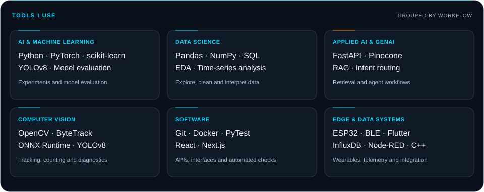
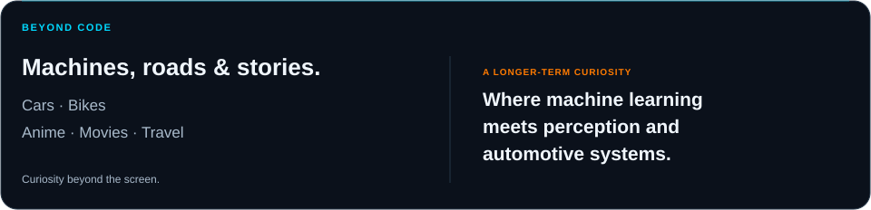

<picture>
  <source media="(prefers-reduced-motion: reduce) and (max-width: 600px)" srcset="v4/motion-proof/assets/hero-mobile-static.svg" />
  <source media="(prefers-reduced-motion: reduce)" srcset="v4/motion-proof/assets/hero-desktop-static.svg" />
  <source media="(max-width: 600px)" srcset="v4/motion-proof/assets/hero-mobile.svg" />
  
</picture>

## 01 / About

I'm an **AI Engineer at Goose Industrial Solutions Pvt. Ltd.**, with a **B.Tech in Artificial Intelligence & Data Science**. I'm interested in turning visual, sensor and tabular data into useful models and applications.

My current work involves industrial data integration and energy monitoring. Alongside that, my portfolio explores **computer vision, retrieval-based AI and time-series analytics**—with attention to data quality, evaluation and how a system behaves outside a demo.

<picture>
  <source media="(max-width: 600px)" srcset="profile-polish/assets/profile-mobile.svg" />
  
</picture>

## 02 / Selected projects

### 01 — [Industrial Conveyor Vision Analytics](https://github.com/IvinePannivelil/Industrial-Conveyor-Vision-Analytics)

`Computer vision` · `Tracking & counting` · `Evaluation`

An extension of a baseline bottle detector into a tracking, counting and analytics workflow.

- **System extension:** persistent ByteTrack IDs, directional line counting, event logging and a dashboard for reviewing results.
- **Reliability work:** failure-mode analysis, dataset diagnostics, ONNX export checks and automated tests.

**Built with:** Python, YOLOv8, OpenCV, ByteTrack, ONNX and PyTest.  
*The baseline detector and original model training were a colleague's work. My contribution focuses on the downstream system, diagnostics and evaluation.*

### 02 — [Multi-Agent Industrial Troubleshooting AI](https://github.com/IvinePannivelil/multi-agent-industrial-troubleshooting-ai)

`Applied AI` · `RAG` · `Intent routing`

A prototype for finding relevant technical information and organising troubleshooting responses from documents.

- **Request routing:** rule-based checks and intent classification direct questions to the relevant specialist workflow.
- **Retrieval:** a FastAPI backend connects document search and Pinecone retrieval with the response workflow.

**Built with:** Python, FastAPI, Pinecone, Next.js and TypeScript.  
*Prototype work exploring retrieval and agent coordination.*

### 03 — [IIoT Dairy Monitoring Dashboard](https://github.com/IvinePannivelil/iiot-dairy-monitoring-dashboard)

`Data science` · `Time series` · `Sensor telemetry`

A dashboard project for exploring industrial sensor data, historical trends and monitoring interfaces.

- **Data workflow:** time-series storage, historical queries and visualisation of equipment readings.
- **Analytics:** trend views and a forecasting demonstration for exploring how readings may approach thresholds.

**Built with:** FastAPI, InfluxDB, React and Docker.  
*Developed collaboratively, with forecasting explored as a demonstration.*

### 04 — [Smart Glasses — Real-Time Transcribing HUD](https://github.com/IvinePannivelil/Smart-Glasses-Real-Time-Transcribing-Glasses)

`Edge & embedded` · `Wearables` · `BLE`

A wearable speech-to-text project connecting a Flutter application to an ESP32 display.

- **Mobile-to-device flow:** transcribed speech is sent over BLE from the phone to the wearable.
- **Hardware integration:** an ESP32 and OLED display present scrolling captions in a compact HUD.

**Built with:** Flutter, Dart, ESP32, BLE, C++ and an SSD1306 OLED.

<strong>Earlier / academic work</strong>

- **[JIVA — Job Seeking Mobile Application](https://github.com/IvinePannivelil/JIVA-Job-Seeking-App)** — a Flutter and Firebase project for job discovery and application tracking.

## 03 / Tools I use

<picture>
  <source media="(max-width: 600px)" srcset="profile-polish/assets/tools-mobile.svg" />
  
</picture>

## 04 / Experience

**AI Engineer · Goose Industrial Solutions Pvt. Ltd.**  
*January 2026 – present*

My work spans applied-AI prototypes, industrial data integration and monitoring software.

- **Applied-AI R&D:** contributed to the internal Goose Sense / industrial-assistant prototype, exploring Next.js interfaces, FastAPI coordination, document retrieval and request routing.
- **Industrial data & monitoring:** collaborated on SCADA–SIMATIC Energy Manager PRO integration over OPC UA, meter mapping and 10 section dashboards using a client-approved template and available energy data. Supported dashboard validation and technical documentation.
- **Monitoring software & deployment:** contributed to a client monitoring dashboard using Python, Node-RED, InfluxDB and Docker, including deployment on Radxa hardware and on-site installation.

**QEA Intern · Cognizant Technology Solutions**  
*2025*

Completed internship training in **Java, Selenium and software testing** as part of Quality Engineering & Assurance (QEA).

## 05 / Beyond code

<picture>
  <source media="(max-width: 600px)" srcset="profile-polish/assets/interests-mobile.svg" />
  
</picture>

## 06 / Currently exploring

- **Reliable ML systems:** dataset quality, failure analysis and model evaluation.
- **Retrieval-based AI:** document search, intent routing and useful troubleshooting workflows.
- **Time-series analytics:** turning sensor data into clearer monitoring and decision support.

## 07 / Get in touch

[LinkedIn](https://www.linkedin.com/in/ivine-pannivelil) · [Email](mailto:ivine3585@gmail.com) · [GitHub](https://github.com/IvinePannivelil)

Interested in **AI Engineer, ML Engineer and Data Scientist** opportunities. Resume available on request.

<picture>
  <source media="(max-width: 600px)" srcset="profile-polish/assets/footer-mobile.svg" />
  
</picture>
